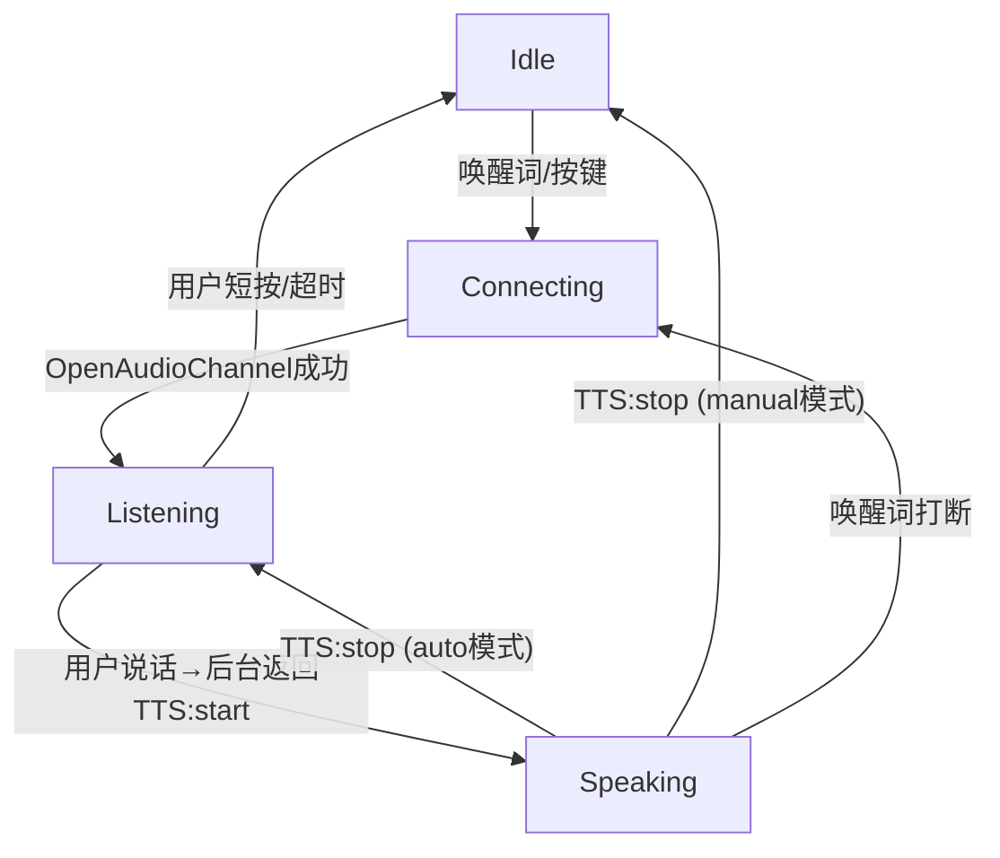

# TTS 语音下发流程分析（原生代码未修改版本）

> 分析日期：2026-07-22  
> 代码基线：`xiaozhi-server-old/` + `esp32-firmware-old/`  
> 分析目标：完整还原用户语音/文本输入 → 设备播报回答的全链路协作流程

---

## 1. 执行摘要

**原生 TTS 语音下发流程的关键特征：后台对 LLM 流式输出进行**流式文本缓冲 + 按标点切句**后，逐句调用 TTS 服务生成 Opus 音频包，通过**带有 AudioRateController 的精准流控**以 60ms 帧间隔分片下发；单句结束时发送 `sentence_start` 通知固件更新字幕，整轮对话结束时发送 `{"type":"tts","state":"stop"}` 通知固件切换状态。固件侧收到 JSON 指令和二进制音频包分别处理后，Opus 解码 → PCM 重采样 → 硬件回放，三者通过三个独立 FreeRTOS 任务流水线并行完成。

---

## 2. 后台侧（xiaozhi-server-old）详细分析

### 2.1 整体架构

```
WebSocket 连接 → ConnectionHandler._route_message()
    ├── 二进制(binary) → ASR 语音识别
    └── 文本(text) → TextMessageProcessor → 消息路由分发
                        ├── "hello" → HelloTextMessageHandler
                        ├── "abort" → AbortTextMessageHandler
                        ├── "listen" → ListenTextMessageHandler
                        ├── "iot" → IotTextMessageHandler
                        └── ...
```

### 2.2 LLM 响应 → TTS 调用的完整链路

**入口点：** `ConnectionHandler.chat()`（`connection.py:907`）

```
用户音频 → VAD检测 → ASR识别 → 文本 → startToChat()
                                              │
                                              ├─ handleAbortMessage()  // 打断当前播放
                                              ├─ send_stt_message()    // 发送{"type":"stt","text":"..."} + {"type":"tts","state":"start"}
                                              │
                                              └─ conn.chat(text)       // 在线程池中执行
                                                   │
                                                   ├─ 生成 sentence_id ──────────────────────┐
                                                   ├─ 向 TTS 队列放入 SentenceType.FIRST      │
                                                   │  （Action 类型，表示新会话开始）            │
                                                   │                                           │
                                                   └─ LLM 流式响应循环                         │
                                                        │                                    │
                                                        │  for每一个chunk:                     │
                                                        │    if content非空且非工具调用:         │
                                                        │      response_message.append(content)│
                                                        │      向 TTS 队列放入                   │
                                                        │      SentenceType.MIDDLE + TEXT       │
                                                        │      content_detail=chunk             │
                                                        │                                      │
                                                        ├─[工具调用]→ 处理工具结果               │
                                                        │               │                      │
                                                        │               └─ tts_one_sentence()   │
                                                        │                                      │
                                                        └─ 循环结束后(depth==0)                  │
                                                          向 TTS 队列放入 SentenceType.LAST ────┘
```

**TTS 处理线程（`tts_text_priority_thread`）：**

位于 `TTSProviderBase.tts_text_priority_thread()`（`base.py:368`）

```
TTS 文本队列 (tts_text_queue)
    │
    ├─ SentenceType.FIRST:
    │   重置状态: sentence_id, processed_chars, tts_text_buff
    │
    ├─ ContentType.TEXT + SentenceType.MIDDLE:
    │   追加到 tts_text_buff
    │   调用 _get_segment_text() 按标点切句
    │   调用 to_tts_stream() → text_to_speak() 生成音频
    │   → opus_handler = handle_opus → tts_audio_queue 放入 (SentenceType.MIDDLE, opus数据, text, sentence_id)
    │
    ├─ ContentType.FILE:
    │   先处理剩余文本流 → 再处理文件
    │
    └─ SentenceType.LAST:
       调用 _process_remaining_text_stream() 处理未处理文本
       向 tts_audio_queue 放入 (SentenceType.LAST, [], None, sentence_id)
```

**音频发送线程（`_audio_play_priority_thread`）：**

位于 `TTSProviderBase._audio_play_priority_thread()`（`base.py:411`）

```
TTS 音频队列 (tts_audio_queue)
    │
    └─ 循环取出 (sentence_type, audio_datas, text, sentence_id)
         │
         ├─ 收集上报数据
         │
         └─ sendAudioMessage(conn, sentence_type, audios, text, sentence_id)
              │
              ├─ [FIRST] send_tts_message("sentence_start", text)
              │     → 发送 {"type":"tts","state":"sentence_start","text":"...","session_id":"..."}
              │
              ├─ sendAudio()  → AudioRateController (60ms帧间隔，精准流控)
              │     ├─ [前5包预缓冲] 直接发送
              │     ├─ [固定延迟模式] sleep后发送
              │     └─ [动态流控模式] 加入队列，由后台循环按时钟发送
              │
              └─ [LAST] send_tts_message("stop", None)
                    → 额外发送stop提示音（可选）
                    → _wait_for_audio_completion() 等待所有音频发送完成
                    → 停止 AudioRateController
                    → clearSpeakStatus()
                    → 发送 {"type":"tts","state":"stop","session_id":"..."}
```

### 2.3 音频下发方式

**分片流式下发。** 每次 TTS 调用生成多个 Opus 帧（每帧 60ms 时长），通过 `AudioRateController` 精确控制发送节奏：

- **帧时长**：60ms（`AUDIO_FRAME_DURATION = 60`，`sendAudioHandle.py:15`）
- **预缓冲**：前 5 个包（`PRE_BUFFER_COUNT = 5`）直接发送无延迟，降低首帧延迟
- **流控器**：`AudioRateController`（`audioRateController.py`）维护虚拟播放位置，确保每个包按 60ms 间隔准确发送
- **发送格式**：二进制裸 Opus 数据包（非WebSocket MQTT网关模式直接 `websocket.send(opus_packet)`）

### 2.4 stop 指令发送时机

**`stop` 指令在 `sendAudioMessage()` 中由 `sentenceType == SentenceType.LAST` 触发**（`sendAudioHandle.py:50-53`）：

**代码位置：** `xiaozhi-server-old/core/handle/sendAudioHandle.py` **第50-53行**

```python
if sentenceType == SentenceType.LAST:
    await send_tts_message(conn, "stop", None)
    if conn.close_after_chat:
        await conn.close()
```

**`send_tts_message("stop")` 的具体流程**（`sendAudioHandle.py:266-299`）：

1. 保存当前 `sentence_id`
2. 可选播放 stop 提示音
3. **等待音频队列全部发送完成**（`_wait_for_audio_completion`：等待流控器队列空 + 预缓冲播放完成后额外等待 `(5+2)*60ms`)
4. 停止 `AudioRateController`
5. 调用 `conn.clearSpeakStatus()`
6. **发送 JSON 消息：** `{"type":"tts","state":"stop","session_id":"..."}`

**另外，打断（abort）时也会发送 stop：**

**代码位置：** `xiaozhi-server-old/core/handle/abortHandle.py` **第16行**

```python
async def handleAbortMessage(conn):
    conn.client_abort = True
    conn.clear_queues()
    await conn.websocket.send(
        json.dumps({"type": "tts", "state": "stop", "session_id": conn.session_id})
    )
    conn.clearSpeakStatus()
```

**触发打断的场景：**
- 用户在 Speaking 状态再次唤醒（新语音输入）
- `client_listen_mode != "manual"` 时用户开始说话，自动打断

---

## 3. 固件侧（esp32-firmware-old）详细分析

### 3.1 整体架构

```
Application::Run() — 主事件循环 (event-driven, FreeRTOS)
    │
    ├─ MAIN_EVENT_SEND_AUDIO:   上传用户音频
    ├─ MAIN_EVENT_WAKE_WORD_DETECTED:  唤醒词检测
    ├─ MAIN_EVENT_VAD_CHANGE:    VAD状态变化
    ├─ MAIN_EVENT_STATE_CHANGED: 状态变化 → UI/功耗更新
    ├─ MAIN_EVENT_ACTIVATION_DONE: 激活完成
    └─ ...
```

**协议层（WebSocket）：**

```
WebsocketProtocol::OpenAudioChannel()
    → 创建 WebSocket 连接
    → 发送 Hello 消息（含音频参数：opus/16kHz/1ch/60ms）
    → 等待 Server Hello
    → 触发 on_audio_channel_opened_

Websocket 数据回调：
    ├─ 二进制(binary) → on_incoming_audio_ → AudioService::PushPacketToDecodeQueue()
    └─ 文本(JSON)   → on_incoming_json_ → 解析 type 字段
```

### 3.2 音频接收和处理流水线

**接收入口：** `application.cc:498-501`

```cpp
protocol_->OnIncomingAudio([this](std::unique_ptr<AudioStreamPacket> packet) {
    if (GetDeviceState() == kDeviceStateSpeaking) {
        audio_service_.PushPacketToDecodeQueue(std::move(packet));
    }
});
```

**处理流水线（三个 FreeRTOS 任务）：**

```
                   OpusCodecTask (opus_codec, 优先级2)
    ┌─────────────────────────┐
    │  Decode Queue           │
    │  (MAX=40包 = 2400ms)    │
    └─────────┬───────────────┘
              │
              ▼
    Opus 解码 → esp_opus_dec_decode()
              │
              ▼
    重采样 (如果采样率不匹配)
              │
              ▼
    ┌─────────────────────────┐
    │  Playback Queue         │
    │  (MAX=2包)              │
    └─────────┬───────────────┘
              │
              ▼
    AudioOutputTask (audio_output, 优先级4)
              │
              ▼
    codec_->OutputData(pcm) → I2S → DAC → Speaker
```

**三个任务的职责：**

| 任务 | 优先级 | 栈大小 | 职责 |
|---|---|---|---|
| **audio_input** | 8 | 2KB×2 | 采集 MIC 数据，送入 AFE 处理 → 编码队列 |
| **audio_output** | 4 | 2KB×2 | 从播放队列取 PCM 数据，写入 I2S 输出 |
| **opus_codec** | 2 | 2KB×12 | **Opus 解码：** DecodeQueue → 解码 → 重采样 → PlaybackQueue |
| | | | **Opus 编码：** EncodeQueue → 编码 → SendQueue |

**解码流程详述（`audio_service.cc:340-391`）：**

1. 从 `audio_decode_queue_` 取出 `AudioStreamPacket`
2. 调用 `SetDecodeSampleRate()` 按需重建解码器
3. `esp_opus_dec_decode()` 解码 Opus → PCM
4. 若解码采样率 ≠ 硬件输出采样率，用 `esp_ae_rate_cvt_process()` 重采样
5. 推入 `audio_playback_queue_`
6. `AudioOutputTask` 取出 PCM → `codec_->OutputData()` → I2S 播放

### 3.3 stop 指令处理

**代码位置：** `esp32-firmware-old/main/application.cc` **第531-540行**

```cpp
protocol_->OnIncomingJson([this, display](const cJSON* root) {
    auto type = cJSON_GetObjectItem(root, "type");
    if (strcmp(type->valuestring, "tts") == 0) {
        auto state = cJSON_GetObjectItem(root, "state");
        if (strcmp(state->valuestring, "start") == 0) {
            // → 设置 aborted_ = false, 切换到 Speaking 状态
        } else if (strcmp(state->valuestring, "stop") == 0) {
            Schedule([this]() {
                if (GetDeviceState() == kDeviceStateSpeaking) {
                    if (listening_mode_ == kListeningModeManualStop) {
                        SetDeviceState(kDeviceStateIdle);   // 手动 → Idle
                    } else {
                        SetDeviceState(kDeviceStateListening); // 自动 → Listening
                    }
                }
            });
        } else if (strcmp(state->valuestring, "sentence_start") == 0) {
            // → 更新屏幕字幕显示
        }
    }
});
```

**stop 处理的完整动作：**

1. 收到 `{"type":"tts","state":"stop"}` JSON 消息
2. 通过 `Schedule()` 安排到主事件循环执行
3. 主循环检查当前状态是否为 `kDeviceStateSpeaking`
4. 根据 `listening_mode_` 切换到：
   - `kListeningModeManualStop` → `kDeviceStateIdle`（闲置）
   - 其他（`kListeningModeAutoStop`） → `kDeviceStateListening`（继续监听）
5. 状态切换会自动触发 UI 更新和功耗策略调整

**注意：** stop 指令**不主动清空音频缓冲区**。缓冲区在 `application.cc:922` 进入 Speaking 状态时通过 `audio_service_.ResetDecoder()` 清空。stop 到达时，只是状态切换，尚未播放完的音频继续播放完（PlaybackQueue 清空后自然结束）。

### 3.4 打断处理（AbortSpeaking）

**代码位置：** `esp32-firmware-old/main/application.cc` **第942-948行**

```cpp
void Application::AbortSpeaking(AbortReason reason) {
    aborted_ = true;
    if (protocol_) {
        protocol_->SendAbortSpeaking(reason);  // → 发送 {"type":"abort"} 给后台
    }
}
```

**触发场景：**
- 唤醒词在 Speaking/Listening 状态下被检测到（`HandleWakeWordDetectedEvent`, line 804-805）
- 用户手动按键（`HandleToggleChatEvent` 或 `HandleStartListeningEvent`, line 759-760）

### 3.5 固件状态机

**定义文件：** `esp32-firmware-old/main/device_state.h`

```cpp
enum DeviceState {
    kDeviceStateUnknown,
    kDeviceStateStarting,
    kDeviceStateWifiConfiguring,
    kDeviceStateIdle,
    kDeviceStateConnecting,
    kDeviceStateListening,
    kDeviceStateSpeaking,
    kDeviceStateUpgrading,
    kDeviceStateActivating,
    kDeviceStateAudioTesting,
    kDeviceStateFatalError
};
```

**实现文件：** `esp32-firmware-old/main/device_state_machine.cc`

**核心状态转换规则：**

```
Unknown ──→ Starting ──→ WifiConfiguring ──→ Activating ──→ Idle
                           │                    │
                           ├──→ AudioTesting     └──→ Upgrading ──→ Idle
                           │
                           ▼
                       Activating ──→ Idle
                                       │
                          ┌────────────┼────────────┐
                          ▼            ▼            ▼
                     Connecting    Listening    Speaking
                          │            │  │          │
                          ▼            │  │          │
                      Listening ───────┘  └──────────┘
                          │                  │
                          └────→ Idle ←──────┘
```

**与 TTS 流程相关的关键路径：**



**状态切换时的`OnStateChanged`处理：**

- **→ Listening**：开启语音处理（AFE）、VAD、唤醒词检测（根据Kconfig），显示表情
- **→ Speaking**：关闭语音处理（除非实时模式），保持AFE唤醒词检测，**ResetDecoder**清空解码/播放缓冲区
- **→ Idle**：关闭语音处理和唤醒词检测，恢复低功耗

---

## 4. 完整交互时序

下面是一次完整的"用户提问 → 设备播报回答"的时序，含音视频分片下发和状态转换：

```
用户                ESP32固件                    xiaozhi后台                   LLM         TTS服务
 │                   │                             │                           │            │
 │  0. 按键/唤醒词    │                             │                           │            │
 │──────────────────►│                             │                           │            │
 │                   │  kDeviceStateConnecting      │                           │            │
 │                   │◄─────────────────────────────┤                           │            │
 │                   │  OpenAudioChannel()          │                           │            │
 │                   │  Hello(opus/16k/1ch/60ms)    │                           │            │
 │                   │─────────────────────────────►│                           │            │
 │                   │  Server Hello(session_id)    │                           │            │
 │                   │◄─────────────────────────────┤                           │            │
 │                   │  kDeviceStateListening       │                           │            │
 │                   │                             │                           │            │
 │  1. 用户说话       │  MIC→Opus编码→上传           │                           │            │
 │──────────────────►│─────────────────────────────►│                           │            │
 │                   │                             │  VAD检测→ASR识别           │            │
 │                   │                             │──────────────────────────►│            │
 │                   │                             │  ASR结果文本               │            │
 │                   │                             │◄──────────────────────────┤            │
 │                   │                             │                           │            │
 │  2. 开始处理       │                             │                           │            │
 │                   │                             │  send_stt_message()       │            │
 │                   │◄──── {"type":"stt","text"}   │                           │            │
 │                   │◄──── {"type":"tts","state":"start"}                      │            │
 │                   │  kDeviceStateSpeaking        │                           │            │
 │                   │  ResetDecoder(清空缓冲区)     │                           │            │
 │                   │  EnableVoiceProcessing(false)│                           │            │
 │                   │                             │                           │            │
 │  3. LLM流式响应    │                             │                           │            │
 │                   │                             │  chat()→LLM响应流          │            │
 │                   │                             │──────────────────────────►│            │
 │                   │                             │  chunk1,chunk2,...         │            │
 │                   │                             │◄──────────────────────────┤            │
 │                   │                             │                           │            │
 │  4. TTS生成+下发   │                             │                           │            │
 │                   │                             │  tts_text_queue.put(chunk) │            │
 │                   │                             │──────────────────────────►│            │
 │                   │                             │  tts_audio_queue.put(opus) │            │
 │                   │                             │◄──────────────────────────┤            │
 │                   │                             │                           │            │
 │                   │◄──── {"type":"tts","state":"sentence_start","text":"..."}│            │
 │                   │  (显示字幕)                   │                           │            │
 │                   │                             │                           │            │
 │  5. 音频分片流     │  Opus包1(60ms)              │  AudioRateController       │            │
 │                   │◄──── binary opus ────────────│  按60ms间隔发送            │            │
 │                   │  Push to DecodeQueue         │                           │            │
 │                   │  OpusDecodeTask→PCM          │                           │            │
 │                   │  →PlaybackQueue→I2S播放      │                           │            │
 │                   │                             │                           │            │
 │                   │  Opus包2(60ms)              │                           │            │
 │                   │◄──── binary opus ────────────┤                           │            │
 │                   │  ...播放中...                 │                           │            │
 │                   │                             │                           │            │
 │                  (循环直到所有opus包发送完毕)      │                           │            │
 │                   │                             │                           │            │
 │  6. 句子结束       │                             │                           │            │
 │                   │  (如果还有下一句)              │                           │            │
 │                   │◄──── sentence_start(新句子)   │                           │            │
 │                   │◄──── opus包流(新句子)         │                           │            │
 │                   │                             │                           │            │
 │  7. 整轮结束       │                             │                           │            │
 │                   │  _wait_for_audio_completion()│  TTS队列收到LAST           │            │
 │                   │  (等待队列空+预缓冲播放完)     │                           │            │
 │                   │                             │                           │            │
 │                   │◄──── {"type":"tts","state":"stop"}                       │            │
 │                   │  kDeviceStateListening/Idle  │                           │            │
 │                   │  (自动/手动模式决定)           │                           │            │
 │                   │                             │                           │            │
 │  8. 用户再说话      │                             │                           │            │
 │  (或返回idle等待)   │  MIC→Opus上传...            │                           │            │
```

---

## 5. 关键代码位置清单

### 5.1 后台侧（xiaozhi-server-old）

| 功能 | 文件 | 行号 | 关键代码 |
|---|---|---|---|
| **LLM 响应流处理** | `core/connection.py` | 1000-1064 | `chat()`方法中的流式响应循环 |
| **TTS 文本入队** | `core/connection.py` | 1057-1063 | `self.tts.tts_text_queue.put(TTSMessageDTO(...))` |
| **TTS 文本处理线程** | `core/providers/tts/base.py` | 368-409 | `tts_text_priority_thread()` 切句 + 调TTS |
| **TTS 音频发送线程** | `core/providers/tts/base.py` | 411-469 | `_audio_play_priority_thread()` 音视频出队发送 |
| **音频速率控制** | `core/utils/audioRateController.py` | 全文 | `AudioRateController` 60ms 帧间隔控制 |
| **sentence_start/stop 发送** | `core/handle/sendAudioHandle.py` | 266-299 | `send_tts_message()` |
| **LAST→stop 触发** | `core/handle/sendAudioHandle.py` | 50-53 | `if sentenceType == SentenceType.LAST: await send_tts_message(conn, "stop")` |
| **打断→stop 发送** | `core/handle/abortHandle.py` | 16 | `await conn.websocket.send({"type":"tts","state":"stop"})` |
| **消息路由** | `core/connection.py` | 332-365 | `_route_message()` |
| **FIRST Action 入队** | `core/connection.py` | 919-925 | `chat()` depth==0 时 |

### 5.2 固件侧（esp32-firmware-old）

| 功能 | 文件 | 行号 | 关键代码 |
|---|---|---|---|
| **音频接收回调** | `main/application.cc` | 498-501 | `protocol_->OnIncomingAudio(...)` |
| **TTS-JSON 解析** | `main/application.cc` | 521-549 | `OnIncomingJson()` 处理 `type:"tts"` |
| **stop 指令处理** | `main/application.cc` | 531-540 | `state:"stop" → SetDeviceState()` |
| **状态机定义** | `main/device_state.h` | 全文 | `enum DeviceState` 11种状态 |
| **状态转换规则** | `main/device_state_machine.cc` | 35-110 | `IsValidTransition()` 合法性验证 |
| **状态切换事件** | `main/device_state_machine.cc` | 110-131 | `TransitionTo()` + `OnStateChanged` |
| **OnStateChanged** | `main/application.cc` | 884-931 | 状态切换时 UI/音频/功耗调整 |
| **Opus 解码** | `main/audio/audio_service.cc` | 340-393 | `OpusCodecTask()` 解码部分 |
| **PCM 输出** | `main/audio/audio_service.cc` | 290-325 | `AudioOutputTask()` I2S写入 |
| **解码缓冲区清空** | `main/audio/audio_service.cc` | 668-680 | `ResetDecoder()` |
| **Spaking 状态进入** | `main/application.cc` | 914-923 | `case kDeviceStateSpeaking:` 调用 `ResetDecoder()` |
| **打断发送** | `main/protocols/protocol.cc` | 52-58 | `SendAbortSpeaking()` |
| **固件 Hello 消息** | `main/protocols/websocket_protocol.cc` | 203-226 | `GetHelloMessage()` |
| **Server Hello 解析** | `main/protocols/websocket_protocol.cc` | 228-254 | `ParseServerHello()` |

---

## 6. 原生流程关键特征总结

### 6.1 架构特征

| 特征 | 描述 |
|---|---|
| **传输协议** | WebSocket (二进制 Opus + JSON 信令) |
| **音频编码** | Opus (16kHz, 单声道, 60ms 帧) |
| **下发顺序** | 先 JSON 信令，后紧跟二进制音频包 |
| **TTS 模式** | 非流式：TTS 服务生成完整音频后再分片下发 |
| **音频流控** | 后台 `AudioRateController` 按 60ms 帧间隔主动控制发送节奏 |
| **固件流水线** | DecodeQueue(40包) → OpusDecoder → PlaybackQueue(2包) → I2S，三任务并行 |

### 6.2 信令序列

```
一轮对话的信令序列（固定三阶段）：
    {"type":"tts","state":"start"}                           // 开始说话
    {"type":"tts","state":"sentence_start","text":"..."}     // 每个句子开始（带字幕）
    <binary opus packets for sentence 1>                     // 句子1音频数据
    {"type":"tts","state":"sentence_start","text":"..."}     // 句子2开始（可选）
    <binary opus packets for sentence 2>                     // 句子2音频数据
    ...
    {"type":"tts","state":"stop"}                            // 整轮结束
```

### 6.3 关键设计决策

1. **非流式 TTS 引擎**：`default.py` 的 `TTSProviderBase` 默认是**非流式**（`InterfaceType.NON_STREAM`），即等 TTS 服务生成完整音频文件后再处理。子类可覆盖为流式。

2. **文本切句**：后台用标点符号（`。！？；:\n`）将 LLM 流式输出的文本缓冲并切句，每个完整句子分别调用 TTS 服务。

3. **音频分片**：每个句子的完整 Opus 音频作为一包发给 `AudioRateController`，控制器将其视为连续流，按 60ms 帧间隔逐包发送。

4. **无音频包对齐标记**：音频包本身不携带帧序号、总时长等元数据，仅靠发送间隔控制时序。

5. **stop 不主动清空缓冲区**：固件收到 stop 后仅切换状态，已入 DecodeQueue/PlaybackQueue 的音频会继续播完。

6. **打断流程**：固件 `AbortSpeaking()` → 发送 `{"type":"abort"}` 给后台 → 后台 `handleAbortMessage()` → 清空 TTS 队列 + 发送 stop → 固件收到 stop 后根据模式转 Listening/Idle。

7. **状态机严格性**：状态转换有严格校验（`IsValidTransition`），非法转换被拒绝并日志告警。

### 6.4 延迟预算

| 阶段 | 延迟构成 | 典型值 |
|---|---|---|
| TTS 生成 | TTS 服务 API 调用 + 音频生成 | 300ms-2s（取决于文本长度和TTS引擎） |
| 首帧缓冲 | 前5包直接发送（无流控延迟） | ≈0ms |
| 音频传输 | 受 WebSocket 网络延迟影响 | 10-100ms |
| 固件解码 | Opus 解码 + 重采样 | <5ms/帧 |
| 预缓冲播放等待 | `(PRE_BUFFER_COUNT+2)*60ms` | 420ms（仅 LAST 时等待） |

### 6.5 局限性（分析基准）

1. **无 VAD 回传 AEC 对齐**：音频下发不带时间戳（非 MQTT 网关模式），服务端 AEC 需要固件通过 `timestamp_queue_` 自行管理。
2. **TTS 引擎阻塞式**：`to_tts_stream()` 中 `asyncio.run()` 同步等待 TTS 服务结果，可能阻塞 TTS 处理线程。
3. **无动态码率适配**：帧时长固定 60ms，不根据网络状况调整。
4. **stop 信号语义模糊**：`stop` 同时表示"本轮结束"和"打断终止"，固件仅凭 `listening_mode_` 区分后续行为。

---
*本文档为原生代码（未修改版本）的完整 TTS 语音下发流程分析，供后续对比优化使用。*
