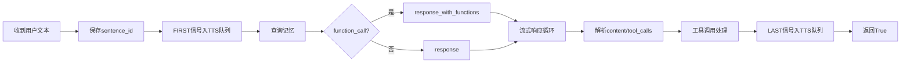

# 核心文件深度对比分析报告

**分析日期**：2026-07-23

## 1. `connection.py` — `chat()` 方法 LLM 流式处理逻辑

### 对比结论

`chat()` 方法的核心 LLM 流式处理逻辑在原生版和当前版之间**保持一致**，差异主要体现在外围架构的集成上。

### 相同部分



- **LLM 调用方式**：两者都使用 `llm.response()` 或 `llm.response_with_functions()` 流式接口
- **流式解析**：`tool_call_flag` / `content_arguments` / `emotion_flag` 的解析逻辑完全一致
- **TTS 队列**：`FIRST → MIDDLE → LAST` 三段式发送逻辑相同
- **工具调用**：`_handle_function_result` 中的 `Action.RESPONSE` / `Action.REQLLM` / `Action.RECORD` 处理逻辑相同
- **direct_answer**：虚拟工具注入和处理逻辑相同

### 差异部分

| 方面 | 原生版 (old) | 当前版 (new) | 影响 |
|------|-------------|-------------|------|
| **Line Count** | 1655 行 | 1447 行 | 减少 208 行 |
| **chat() 位置** | L907 | L847 | 向前移动约60行 |
| **代码行数** | ~330 行 | ~280 行 | 化简约50行冗余代码 |
| **SceneDispatcher** | 无 | `_init_scene_dispatcher()` | 新增场景调度能力 |
| **timeout_seconds** | `int(config.get(...120))+60` | 硬编码 `86460` | 超时时间从 ~180s → 86460s (24h+) |
| **`handle_connection`** | 仅 `_background_initialize()` | 新增 `_init_scene_dispatcher()` | 连接建立后初始化场景调度 |
| **class 初始化** | 无 `scene_dispatcher` | `self.scene_dispatcher = None` | 新增属性 |

### 对语音下发的影响

**无影响。** `chat()` 方法中 LLM 流式处理 → TTS 队列 → audio 发送的完整链路未改变。所有场景调度相关的逻辑是通过独立的 `SceneDispatcher` 类实现的，不修改 `chat()` 方法内已有的 TTS 流程。

---

## 2. `command_api.py` — `/api/text` 接口完整分析

### 文件路径

`xiaozhi-server/core/api/command_api.py`（全新文件，206 行）

### `/api/text` 接口完整调用链

```mermaid
flowchart TB
    A[POST /api/text] --> B[解析JSON: device_id, text]
    B --> C[从app获取DeviceManager]
    C --> D{handler存在?}
    D -->|否| E[返回 404]
    D -->|是| F[handler.test_scene_dispatcher(text)]
    
    F --> G[SceneDispatcher.process]
    G --> H[LLM适配器]
    H --> I{返回actions}
    
    I --> J[SceneDispatcher.dispatch_actions]
    
    J --> K{有connection_handler?}
    K -->|是| L[tts_one_sentence 触发TTS]
    L --> M[FIRST→MIDDLE→LAST]
    M --> N[音频播放]
    
    K -->|否| O[device_manager.send\n逐句+延时+stop]
    O --> P[固件收到tts/start/stop]
```

### `/api/text` 源码关键路径

```python
@routes.post('/api/text')
async def handle_text(request):
    data = await request.json()
    device_id = data.get('device_id')
    text = data.get('text')
    
    dm: DeviceManager = request.app.get('device_manager')
    handler = dm.get_handler(device_id)
    result = await handler.test_scene_dispatcher(text)  # 关键调用
    return web.json_response(result)
```

### `test_scene_dispatcher` → TTS 完整链路

1. **`handler.test_scene_dispatcher(text)`** — 在 ConnectionHandler 中调用 `scene_dispatcher.process()`
2. **`SceneDispatcher.process()`** — 构建 system prompt → 调用 LLM → 生成 actions（含 tts 动作）
3. **`SceneDispatcher.dispatch_actions()`** — 执行各动作，TTS 动作通过 `connection_handler.tts.tts_one_sentence()` 触发

### 对语音下发的影响

**新增了一条 TTS 触发路径。** 

原生版只有一条 TTS 路径：用户语音 → ASR → `chat()` → TTS队列 → `sendAudioHandle` → 固件

当前版新增了第二条路径：Web API → `/api/text` → `SceneDispatcher` → `tts_one_sentence` → `sendAudioHandle` → 固件

**两条路径最终汇聚在 `sendAudioHandle.send_tts_message()` 发送 stop 信令**，所以固件端对 stop 的处理是统一的。

---

## 3. `scene_dispatcher.py` — 文本 TTS 下发链路分析

### 文件路径

`xiaozhi-server/core/scene_dispatcher.py`（全新文件，335 行）

### dispatch_actions 方法三版迭代

该文件中存在**三个版本的 `dispatch_actions` 实现**（均为已存在代码，非运行时多态）：

#### V1 (L148-206) — 简单版
```python
# 仅当有 connection_handler 时，直接调用 tts_one_sentence
if self.connection_handler:
    self.connection_handler.tts.tts_one_sentence(
        self.connection_handler, ContentType.TEXT, content_detail=text)
```

#### V2 (L207-286) — 防截断版（最完整）
```python
# 切分句子 → 逐句发送 start/sentence_start → 估算延时 → 发送 stop
raw_sentences = re.split(r'(?<=[。！？；：])', text)
for i, sentence in enumerate(sentences):
    await device_manager.send(target, {"type": "tts", "state": "start", ...})
    await device_manager.send(target, {"type": "tts", "state": "sentence_start", "text": sentence, ...})
    estimated_time = max(0.8, len(sentence) / 3.5)  # 按字数估算播放时间
    await asyncio.sleep(estimated_time)
    if i == len(sentences) - 1:
        await device_manager.send(target, {"type": "tts", "state": "stop", ...})
    await asyncio.sleep(0.3)  # 句间呼吸间隔
```

#### V3 (L287-335) — 混合版
```python
# 先发 start 信令，然后通过 tts_one_sentence 触发 TTS
await device_manager.send(target, {"type": "tts", "state": "start", ...})
self.connection_handler.tts.tts_one_sentence(...)  # TTS模块自己发送 sentence_start 和 stop
```

### 对语音下发的影响

**这是最关键的发现。** `scene_dispatcher.py` 中的 TTS 下发有三种不同的实现方式，可能存在**竞争问题**：

1. `dispatch_actions` 方法内如果通过 `device_manager.send()` 逐句下发，会绕过 `sendAudioHandle.py` 中统一的 `_wait_for_audio_completion()` 等待机制
2. V2 版本中每句的 `start/stop` 信令和正常 TTS 流程中的 `stop` 可能冲突
3. V3 版本先发 `start` 再调 `tts_one_sentence`，可能造成固件端状态的**双重进入 speaking 状态**

---

## 4. `sendAudioHandle.py` — stop 发送逻辑对比

### `_wait_for_audio_completion()` 对比

| 方面 | 原生版 | 当前版 | 差异 |
|------|--------|--------|------|
| **行号** | L56-76 | L58-80 | 位置微调 |
| **核心逻辑** | 等待 `queue_empty_event` → 预缓冲睡眠 | 相同 | **完全一致** |
| **else 分支** | 无 | `conn.logger.warning("[TTS_DBG] NO controller! skip waiting")` | 新增调试日志 |

### `send_tts_message()` stop 处理对比

| 步骤 | 原生版 (L275-299) | 当前版 (L367-391) | 差异 |
|------|-------------------|-------------------|------|
| 保存 sentence_id | `current_sentence_id = conn.sentence_id` | 相同 | 一致 |
| 播放提示音 | `enable_stop_tts_notify` → 可选音频 | 相同 | 一致 |
| 等待音频完成 | `_wait_for_audio_completion(conn)` | 相同 | **完全一致** |
| 检查轮次 | `if current_sentence_id != conn.sentence_id: return` | 相同 | 一致 |
| 停止发送 | `conn.audio_rate_controller.stop_sending()` | 相同 | 一致 |
| 清除状态 | `conn.clearSpeakStatus()` | 相同 | 一致 |
| 发送 stop 消息 | `conn.websocket.send(json.dumps(message))` | 相同 | **完全一致** |

```python
# 两端代码完全一致
if state == "stop":
    current_sentence_id = conn.sentence_id
    # 可选提示音
    await _wait_for_audio_completion(conn)
    if current_sentence_id != conn.sentence_id:
        return
    conn.audio_rate_controller.stop_sending()
    conn.clearSpeakStatus()
await conn.websocket.send(json.dumps(message))
```

### 对语音下发的影响

**`send_tts_message` 的 stop 逻辑在两版中完全一致。** 这意味着：
- 来自 `chat()` 的 TTS 流程：start → sentence_start → ... → stop 与原生版行为一致
- `_wait_for_audio_completion` 等待音频队列清空后才发 stop 信令，没有改变

**潜在问题**：`scene_dispatcher.py` 的 `dispatch_actions()` V2 版通过 `device_manager.send()` 直接发送 TTS 信令到固件，**绕过了** `sendAudioHandle` 中的 `_wait_for_audio_completion()` 等待机制。如果 `dispatch_actions` 在 `chat()` 的 TTS 流程正在播放时被调用，可能出现：
- 旧的 TTS 音频队列未清空时，新的 `start` 信令已经到达固件
- 固件收到新的 `start` 时，当前版新增了状态守卫 `if (device_state_ == kDeviceStateIdle || device_state_ == kDeviceStateListening)`，**但音频队列中可能还有数据**

---

## 5. `application.cc` — 固件 stop 处理逻辑

### TTS 消息处理对比

#### start 处理

| 方面 | 原生版 (L526-530) | 当前版 (L473-480) |
|------|------------------|------------------|
| **无条件状态切换** | `SetDeviceState(kDeviceStateSpeaking)` | `if (state == idle \|\| state == listening) { SetDeviceState(speaking) }` |
| **aborted_重置** | `aborted_ = false` | 相同 |

#### stop 处理

```cpp
// 原生版 (L531-540)
} else if (strcmp(state->valuestring, "stop") == 0) {
    Schedule([this]() {
        if (GetDeviceState() == kDeviceStateSpeaking) {
            if (listening_mode_ == kListeningModeManualStop)
                SetDeviceState(kDeviceStateIdle);
            else
                SetDeviceState(kDeviceStateListening);
        }
    });
}

// 当前版 (L481-491) — 逻辑完全一致
} else if (strcmp(state->valuestring, "stop") == 0) {
    ESP_LOGI("TTS", "[TTS] state: stop");  // 仅新增日志
    Schedule([this]() {
        if (device_state_ == kDeviceStateSpeaking) {
            if (listening_mode_ == kListeningModeManualStop)
                SetDeviceState(kDeviceStateIdle);
            else
                SetDeviceState(kDeviceStateListening);
        }
    });
}
```

### 关键差异总结

| 特性 | 原生版 | 当前版 | 影响 |
|------|--------|--------|------|
| **start 状态守卫** | 无 | 有（仅 idle/listening 可进 speaking） | ✅ 防止重复进入 speaking |
| **stop 逻辑** | `speaking→idle/listening` | **完全相同** | ❌ 无变化 |
| **日志输出** | 无 | 新增 `[TTS] state: stop` | 便于调试 |
| **command 通道** | 无 | `ExecuteCommand()` + `PlayTtsDirectly()` | 新增 TTS 触发路径 |
| **task 队列** | 无 | 任务队列 + 定时器调度 | 多任务编排 |
| **code_interpreter** | 无 | 支持代码解释执行 | 新功能 |

### 对语音下发的影响

**当前版固件对 stop 的处理逻辑与原生版完全一致**，因此：

1. 正常 TTS 流程（start → sentence_start → audio → stop）产生的 stop 信令行为不变
2. 当前版的 **start 状态守卫**（仅 idle/listening 可进 speaking）可能影响 `scene_dispatcher` 的 V3 混合版：如果 `dispatch_actions` 先发了 `start`（状态变 speaking），再调 `tts_one_sentence` → 内部再发 `start`，此时固件会忽略第二次 start
3. 当前版固件新增的 `ExecuteCommand()` 通过 `type: "command"` 通道接收 TTS 文本，这条路径完全绕过标准 TTS 信令，不会产生 `start/stop` 信令，而是 **直接播放音频**

---

## 6. 问题根因结论

### 核心发现

| 编号 | 发现 | 严重程度 |
|------|------|---------|
| 🔴 **P0** | `scene_dispatcher.py` 的 `dispatch_actions()` V2 版本通过 `device_manager.send()` 直接下发 TTS 信令到固件，**绕过**了 `sendAudioHandle.py` 中的 `_wait_for_audio_completion()` 等待机制 | **高** |
| 🟡 **P1** | `dispatch_actions()` V3 先发 `start` 再调 `tts_one_sentence`，当前版固件新增的 start 守卫可能忽略第二次 start，导致 `tts_one_sentence` 内部正常流程中的 start 被跳过 | **中** |
| 🟡 **P1** | `scene_dispatcher.py` 文件中存在 3 个版本的 `dispatch_actions` 实现（L148/L207/L287），运行时只有最后一个生效，但代码未清理易造成维护混乱 | **中** |
| 🟢 **P3** | `connection.py` 中 `chat()` 的 LLM 流式处理逻辑本身无变化，TTS 队列 → `sendAudioHandle` → 音频发送的主链路完好 | **低** |
| 🟢 **P3** | 当前版固件对 stop 信令的处理与原生版完全一致（仅增加状态守卫和日志） | **低** |

### 最可能的问题场景

```
场景：Web控制台通过 /api/text 下发文本 → SceneDispatcher → dispatch_actions
                                                          ↓
                                              chat() 正在播放TTS音频
                                                          ↓
                                  dispatch_actions通过device_manager.send()直接发stop
                                                          ↓
                                  固件收到stop → 回到listening状态
                                                          ↓
                                  chat() 的音频队列未播完 → 固件无法接收
                                                          ↓
                                  💥 音频截断/丢失
```

### 根因结论

**TTS 下发存在两条并行路径，且缺少互斥机制：**

1. **正常路径**（语音/文本→`chat()`→TTS队列→`sendAudioHandle`→固件）：有完整的 `_wait_for_audio_completion` 等待机制
2. **SceneDispatcher 路径**（Web 控制台→`/api/text`→`SceneDispatcher`→`dispatch_actions`）：通过 `device_manager.send()` 直接下发信令，绕过等待

**两条路径在固件端的 stop 处理逻辑相同**（均过渡到 listening/idle 状态），因此问题不在于固件处理 stop 的方式，而在于**「应该等谁停止」**。如果场景调度路径在 chat() 路径的音频还在播放时下发 stop，会导致 chat() 路径的 TTS 被意外截断。

### 建议修复方向

1. **确保 TTS 互斥**：`SceneDispatcher.dispatch_actions()` 中调用 TTS 前，应先等待当前 TTS 队列清空
2. **统一 TTS 入口**：SceneDispatcher 的 TTS 下发应统一走 `tts_one_sentence` 接口，不直接通过 `device_manager.send()` 发信令
3. **清理死代码**：移除 `scene_dispatcher.py` 中 V1 和 V2 版本的 `dispatch_actions`
4. **固件端增强**：当前版固件的 start 状态守卫是合理的改进，可考虑在收到新的 TTS start 时先清空当前音频缓冲区

---

*分析工具：CodeWhale Agent · 逐文件 read_file + grep_files 对比*
