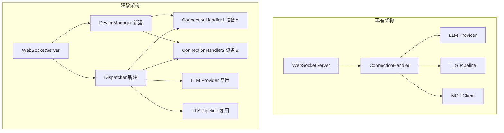

# xiaozhi-server 后台深度分析报告

> **日期**: 2026-07-04
> **用途**: 多机器人调度改造前的代码侦察

---

## 一、整体结构

### 1.1 目录树（.py 文件分类）

```
xiaozhi-server/
├── app.py                         # 入口：启动 WebSocket + HTTP 服务
├── config.yaml                    # 主配置文件（1170行）
├── config_from_api.yaml               # API模式配置模板
├── agent-base-prompt.txt               # LLM 系统提示词模板
├── mcp_server_settings.json            # MCP 服务端配置
├── requirements.txt                    # Python 依赖
│
├── config/
│   ├── settings.py                     # 配置加载入口
│   ├── config_loader.py                # 配置文件读取
│   ├── logger.py                       # 日志配置
│   └── manage_api_client.py            # API管理客户端
│
├── core/                               # ★ 核心逻辑
│   ├── websocket_server.py             # WebSocket 服务（连接入口）
│   ├── connection.py                   # ★ 连接处理器（1830行，核心）
│   ├── world.py                        # World 多角色调度
│   ├── character.py                    # Character 角色定义
│   ├── llm_adapter.py                  # LLM 适配器
│   ├── http_server.py                  # HTTP/Ota 服务
│   ├── auth.py                         # 认证管理
│   │
│   ├── handle/                         # 消息处理器
│   │   ├── helloHandle.py              # Hello 消息处理
│   │   ├── textHandle.py               # 文本消息路由入口
│   │   ├── textMessageHandler.py       # 文本消息处理器
│   │   ├── textMessageHandlerRegistry.py
│   │   ├── textMessageProcessor.py
│   │   ├── textMessageType.py
│   │   ├── receiveAudioHandle.py       # 音频消息处理（含 VAD）
│   │   ├── sendAudioHandle.py          # 音频下行发送
│   │   ├── abortHandle.py              # 中断处理
│   │   ├── intentHandler.py            # 意图识别处理
│   │   └── reportHandle.py             # 上报处理
│   │
│   ├── providers/                      # 各模块适配器
│   │   ├── llm/                        # LLM 提供者
│   │   │   ├── base.py                 # 基类
│   │   │   ├── system_prompt.py        # 工具调用提示词
│   │   │   ├── openai/                 # OpenAI兼容（默认）
│   │   │   ├── gemini/                 # Gemini
│   │   │   ├── ollama/                 # Ollama
│   │   │   ├── coze/                   # Coze
│   │   │   ├── dify/                   # Dify
│   │   │   └── ...                     # 其他
│   │   ├── tts/                        # TTS（21个提供者）
│   │   │   ├── base.py                 # 基类（636行）
│   │   │   ├── edge.py                 # Edge TTS
│   │   │   ├── doubao.py               # 豆包 TTS
│   │   │   ├── aliyun.py               # 阿里云 TTS
│   │   │   ├── openai.py               # OpenAI TTS
│   │   │   └── ...                     # 等等
│   │   ├── asr/                        # ASR（多个提供者）
│   │   ├── vad/                        # VAD
│   │   ├── memory/                     # 记忆模块
│   │   ├── intent/                     # 意图识别
│   │   ├── vllm/                       # 视觉模型
│   │   └── tools/                      # 工具
│   │       └── device_mcp/             # ★ 设备端MCP客户端
│   │           ├── mcp_client.py       # MCP 客户端
│   │           ├── mcp_handler.py      # MCP 消息处理
│   │           └── mcp_executor.py     # MCP 执行器
│   │
│   └── utils/                          # 工具函数
│       ├── util.py                     # 通用工具
│       ├── dialogue.py                 # 对话管理
│       ├── prompt_manager.py           # 提示词管理
│       ├── textUtils.py                # 文本处理
│       └── ...                         # 其他
│
├── models/                             # AI模型文件
│   ├── SenseVoiceSmall/                # 语音识别模型
│   └── snakers4_silero-vad/            # VAD 模型
│
├── plugins_func/                       # 函数插件
│   ├── loadplugins.py                  # 自动加载
│   ├── register.py                     # 注册
│   └── functions/                      # 具体实现
│       ├── web_search.py               # 联网搜索
│       ├── get_weather.py              # 天气查询
│       ├── get_news.py                 # 新闻
│       ├── play_music.py               # 音乐播放
│       └── ...                         # 其他
│
├── performance_tester/                 # 性能测试工具（辅助）
│   ├── performance_tester_llm.py
│   ├── performance_tester_tts.py
│   ├── performance_tester_asr.py
│   └── performance_tester_vllm.py
│
├── performance_tester.py               # 测试入口
├── data/                               # 运行时数据
│   ├── .config.yaml                    # 用户覆盖配置
│   └── bin/                            # OTA 固件目录
│
└── tmp/                                # 缓存/日志目录
```

### 1.2 文件分类评估

| 分类 | 文件 | 行数 | 评估 |
|------|------|------|------|
| ★★★ 核心 | `core/connection.py` | 1830 | 需修改（多设备分发） |
| ★★★ 核心 | `core/websocket_server.py` | 249 | 需修改（设备管理） |
| ★★★ 核心 | `core/handle/receiveAudioHandle.py` | 209 | 需修改（World调度） |
| ★★★ 核心 | `core/handle/sendAudioHandle.py` | 342 | 可直接复用 |
| ★★★ 核心 | `core/handle/helloHandle.py` | 186 | 可直接复用 |
| ★★★ 核心 | `core/providers/` | 大量 | 可直接复用 |
| ★★ 改造 | `core/world.py` | 116 | 📝 可参考（需重写） |
| ★★ 改造 | `core/character.py` | 113 | 📝 可参考（需重写） |
| ★★ 改造 | `core/llm_adapter.py` | 65 | 📝 可参考（需重写） |
| ★ 临时测试 | `performance_tester.py` | 69 |  需重写 |
| ★ 临时测试 | `performance_tester/` | 6文件 |  需重写 |
| — 配置 | `config.yaml` | 1170 |  需修改 |
| — 依赖 | `requirements.txt` | 38 |  可直接复用 |

---

## 二、消息处理流程

### 2.1 WebSocket 消息入口

```
📥 设备连接 → WebSocketServer._handle_connection()  [websocket_server.py:83]
   ├─ 认证 → _handle_auth()                           [websocket_server.py:112]
   └─ 创建 ConnectionHandler                          [websocket_server.py:119]
       └─ handler.handle_connection(websocket)          [connection.py:335]
           └─ 消息路由 → _route_message()              [connection.py:385-386]
```

**文件与行号**:
- `core/websocket_server.py:73-81` — `start()` / 启动`websockets.serve`
- `core/websocket_server.py:83-166` — `_handle_connection()` / 处理新连接
- `core/websocket_server.py:130-143` — **设备注册到 `self.connections` 字典**

### 2.2 消息路由步骤

```
_route_message(message)                               [connection.py:477]
│
├─ message 是 str (JSON)
│   └─ handleTextMessage(conn, message)               [handle/textHandle.py]
│       └─ TextMessageProcessor.process_message()      [textMessageProcessor.py]
│           ├─ type == "hello" → helloHandle            [helloHandle.py]
│           ├─ type == "mcp"   → MCP消息处理            [device_mcp/mcp_handler.py]
│           ├─ type == "llm"   → LLM直通转发            [connection.py:496-506]
│           ├─ type == "iot"   → 设备控制
│           └─ type == "listen" → 监听控制
│
└─ message 是 bytes (音频)
    └─ asr_audio_queue.put(message)                    [connection.py:524]
        └─ ASR 线程消费 → VAD + ASR → startToChat()    [receiveAudioHandle.py:49]
            ├─ World 调度 → 多角色流程                  [receiveAudioHandle.py:92-128]
            └─ 原始流程 → send_stt_message + LLM chat   [receiveAudioHandle.py:131-133]
```

### 2.3 消息下行到设备

```
LLM 响应流式处理                              [connection.py:1174-]
  → TTS 文本队列                              [connection.py:1093-]
  → TTS 线程处理 → 文本转语音                  [tts/base.py:123-]
  → sendAudioMessage()                        [sendAudioHandle.py:20]
    → send_tts_message(conn, type, text)       [sendAudioHandle.py ☞ ws.send]
    → sendAudio(conn, audios)                  [sendAudioHandle.py:105]
      → AudioRateController 流控               [audioRateController.py]
      → conn.websocket.send(audio_bytes)       [最终发送]
```

**下行消息类型**:
| 类型 | 格式 | 用途 |
|------|------|------|
| TTS start | `{"type":"tts","state":"start"}` | 开始播报 |
| TTS sentence_start | `{"type":"tts","state":"sentence_start","text":"..."}` | 每句文本 |
| STT text | `{"type":"stt","text":"..."}` | 用户语音识别文本 |
| LLM emotion | `{"type":"llm","emotion":"happy"}` | 表情指令 |
| Audio | opus 编码的二进制帧 | 音频数据 |
| MCP | `{"type":"mcp","payload":{...}}` | MCP 协议消息 |

### 2.4 评估

| 组件 | 评估 | 说明 |
|------|------|------|
| 消息路由 | 📝 可参考 | `_route_message` 结构清晰，但需扩展多设备路由 |
| 音频处理 |  可直接复用 | VAD/ASR/TTS全部可复用 |
| MCP 处理 |  可直接复用 | `device_mcp/` 实现完整 |
| **多设备下行** |   **需修改** | 当前只对 `conn.websocket.send()`，需改为按 device_id 查找 |

---

## 三、LLM 调用

### 3.1 LLM 调用位置

```
chat() [connection.py:1081]
  │
  ├─ 构建 dialogue (含记忆和工具)          [connection.py:1137-1162]
  │
  ├─ self.llm.response(session_id, dialogue)   [LLMProviderBase.response]
  │   └─ openai client.chat.completions.create  [openai/openai.py:113]
  │
  └─ 流式处理 response                         [connection.py:1174-]
      ├─ 文本内容 → TTS 队列
      ├─ 工具调用 → func_handler
      └─ 表情指令 → 下行
```

### 3.2 当前 Provider

配置 (`config.yaml:238`):
```yaml
selected_module:
  LLM: ChatGLMLLM   # 当前使用智谱 glm-4-flash（免费）
```

LLM 配置 (`config.yaml:653-660`):
```yaml
ChatGLMLLM:
  type: openai                  # OpenAI 兼容接口
  model_name: glm-4-flash       # 免费模型
  url: https://open.bigmodel.cn/api/paas/v4/
  api_key: 你的chat-glm web key
```

**支持的 Provider 清单**:
| 名称 | type | 说明 |
|------|------|------|
| AliLLM | openai | 阿里云通义千问 |
| DoubaoLLM | openai | 字节豆包 |
| DeepSeekLLM | openai | DeepSeek |
| ChatGLMLLM | openai | **智谱（当前使用，免费）** |
| OllamaLLM | ollama | 本地部署 |
| DifyLLM | dify | Dify 平台 |
| GeminiLLM | gemini | Google Gemini |
| CozeLLM | coze | 扣子 |
| FastgptLLM | fastgpt | FastGPT |
| XinferenceLLM | xinference | 本地推理 |

**所有 Provider 都基于 `LLMProviderBase` 基类**，统一接口：`response(session_id, dialogue) → generator`

### 3.3 Prompt 构建

```
system_prompt                                   [config.yaml:203-216]
  ↓
PromptManager.build_enhanced_prompt()           [prompt_manager.py]
  ├─ base_prompt                                [配置中的 prompt]
  ├─ context_providers                          [外部数据注入：时间、天气等]
  └─ voiceprint_info                            [声纹识别信息]
      ↓
dialogue = [system_msg, ..., user_msg]          [dialogue.py]
  ├─ 历史对话                                    [Dialogue.dialogue]
  ├─ 记忆注入                                    [memory.query_memory]
  ├─ few-shot 示例                               [connection.py:737-773]
  └─ 工具定义 (function_call模式)                [func_handler.get_functions]
      ↓
LLM API request                                [openai/openai.py]
```

### 3.4 评估

| 组件 | 评估 | 说明 |
|------|------|------|
| LLM Provider |  可直接复用 | 所有 provider 均可直接使用 |
| Prompt 管理 |  可直接复用 | `prompt_manager.py` 功能完整 |
| 工具调用 |  可直接复用 | `func_handler` + `device_mcp/` 完整 |
| **多角色调度** |   **需修改** | 当前 World 模块和 Connection 紧耦合，需拆分为独立调度层 |

---

## 四、设备管理

### 4.1 设备注册

**WebSocketServer 层** (`websocket_server.py:130-143`):
```python
# 创建 handler
handler = ConnectionHandler(...)

# 从 headers 获取 device_id
headers = dict(websocket.request.headers)
device_id = headers.get("device-id", None)
handler.device_id = device_id

# 注册到 connections 字典 ★
self.connections[handler.device_id] = handler
```

**Connection 层** (`connection.py:353`):
```python
self.device_id = self.headers.get("device-id", None)
```

### 4.2 设备状态存储

**当前存储位置**：
| 数据 | 存储位置 | 类型 |
|------|---------|------|
| 设备连接 | `WebSocketServer.connections` | `Dict[str, ConnectionHandler]` |
| 设备ID | `ConnectionHandler.device_id` | string |
| 对话历史 | `ConnectionHandler.dialogue` | `Dialogue` 对象 |
| 会话ID | `ConnectionHandler.session_id` | UUID string |
| 功能声明 | `ConnectionHandler.features` | dict (mcp/...) |
| 客户端IP | `ConnectionHandler.client_ip` | string |
| 设备headers | `ConnectionHandler.headers` | dict |

**状态均为内存存储**，无数据库。设备断开后 `finally` 块删除 (`websocket_server.py:150-152`):
```python
if handler.device_id and handler.device_id in self.connections:
    del self.connections[handler.device_id]
```

### 4.3 向指定设备发送指令

**当前都是单设备模式**，所有消息通过 `conn.websocket.send()` 发回当前设备。

**已有的多设备路由尝试** (`connection.py:496-506`):
```python
# llm 直通转发（转发到其他设备）
if data.get("type") == "llm":
    target = data.get("target")
    if target and target in self.server.connections:
        handler = self.server.connections[target]
        await handler.websocket.send(json.dumps(data))
```

**World 调度的多设备尝试** (`receiveAudioHandle.py:99-128`):
```python
# 硬编码的 device_id
target_device_id = "58:e6:c5:58:0c:58"  # 双目屏
device_conn = conn.server.connections.get(target_device_id)
```

### 4.4 评估

| 功能 | 评估 | 说明 |
|------|------|------|
| 设备注册 |  可直接复用 | `connections` 字典基础好 |
| 状态存储 | 📝 可参考 | 全部内存存储，多设备需考虑持久化 |
| **多设备路由** |   **需重写** | 当前只有单设备直发和硬编码ID |
| 设备发现 |   **需新增** | 无设备列表/状态查询API |
| 设备绑定 |  可直接复用 | `need_bind` / `bind_code` 机制完整 |

---

## 五、临时/测试代码

### 5.1 文件清单

| 文件 | 行数 | 评估 | 说明 |
|------|------|------|------|
| `performance_tester.py` | 69 |  需重写 | 性能测试入口，与本项目无关 |
| `performance_tester/performance_tester_llm.py` | — |  需重写 | LLM性能测试 |
| `performance_tester/performance_tester_tts.py` | — |  需重写 | TTS性能测试 |
| `performance_tester/performance_tester_asr.py` | — |  需重写 | ASR性能测试 |
| `performance_tester/performance_tester_vllm.py` | — |  需重写 | VLLM性能测试 |
| `performance_tester/performance_tester_stream_asr.py` | — |  需重写 | 流式ASR测试 |
| `performance_tester/performance_tester_stream_tts.py` | — |  需重写 | 流式TTS测试 |
| `data/bin/` | — |  需清理 | OTA固件文件，与本项目无关 |
| `.agents/` | — |  需清理 | CodeWhale 工作目录 |
| `.idea/` | — |  需清理 | IDE 配置 |

### 5.2 功能复用评估总结

| 功能模块 | 复用策略 | 说明 |
|----------|---------|------|
| **ASR 管道** |  直接复用 | VAD → ASR → 文本 全链路完整 |
| **TTS 管道** |  直接复用 | 文本 → TTS → Opus → 流控 → 发送 完整 |
| **LLM Provider** |  直接复用 | 21个LLM提供者+全部缓存机制 |
| **MCP 客户端** |  直接复用 | mcp_client.py 完整实现protocol |
| **意图识别** |  直接复用 | function_call模式稳定 |
| **记忆系统** |  直接复用 | mem0ai/powermem/nomem 全支持 |
| **对话管理** |  直接复用 | Dialogue 类完整 |
| **提示词管理** |  直接复用 | PromptManager 含上下文注入 |
| **音频流控** |  直接复用 | AudioRateController 精确控制 |
| **认证系统** |  直接复用 | JWT + 白名单 |
| **OTA 接口** |  直接复用 | HTTP OTA完整实现 |
| **World 调度** |  需重写 | 当前紧耦合Connection，需独立调度层 |
| **Character 角色** |  需重写 | 当前是简版实现，需扩展 |
| **设备管理** |  需重写 | 需支持多设备注册/查找/状态 |
| **多设备路由** |  需重写 | 需根据角色/场景分发消息 |

---

## 六、配置和依赖

### 6.1 配置文件

| 文件 | 说明 |
|------|------|
| `config.yaml` | **主配置**（1170行），含所有模块配置 |
| `data/.config.yaml` | 用户覆盖配置，优先级高于 `config.yaml` |
| `config_from_api.yaml` | API模式配置模板 |
| `agent-base-prompt.txt` | LLM 基础提示词模板 |
| `mcp_server_settings.json` | MCP 服务端设置 |

### 6.2 外部依赖

| 依赖 | 用途 | 必要性 |
|------|------|--------|
| **websockets** | WebSocket 服务 |  必需 |
| **aiohttp** | HTTP OTA 服务 |  必需 |
| **openai** | LLM API 调用 |  必需 |
| **loguru** | 日志 |  必需 |
| **ruamel.yaml** | YAML 配置解析 |  必需 |
| **cJSON** | JSON 处理（固件端） |  固件必需 |
| **PyJWT** | JWT 认证 |  推荐 |
| **Silero VAD** | 语音活动检测 |  若用语音输入 |
| **FunASR** | 本地语音识别 |  若用本地ASR |
| **Edge TTS** | 文本转语音 |  若用EdgeTTS |
| **opuslib** | Opus 编码/解码 |  若用Opus格式 |
| **dashscope** | 阿里云 LLM |  可选 |
| **baidu-aip** | 百度 ASR |  可选 |
| **mem0ai** | 记忆系统 |  可选 |
| **powermem** | 记忆系统 |  可选 |
| **MCP Python SDK** | MCP 协议 |  可选 |
| **Redis** | — | ❌ **未使用** |
| **数据库** | — | ❌ **未使用** |

> **关键发现**: 系统**无 Redis、无 MySQL/SQLite**。设备状态、对话历史全部**内存存储**。持久化仅通过记忆模块（mem0ai/powermem）和日志文件。

---

## 七、整合建议

### 7.1 核心改造点



### 7.2 具体整合步骤

**Step 1: 提取独立模块（复用现有代码）**
- `core/providers/` → 全部保留，零修改
- `core/utils/` → 全部保留
- `core/handle/sendAudioHandle.py` → 保留
- `core/handle/receiveAudioHandle.py` → 保留音频处理，修改多设备部分
- `core/handle/helloHandle.py` → 保留
- `core/providers/tools/device_mcp/` → 保留

**Step 2: 新增设备管理器**
- `DeviceManager` 类管理多设备注册/注销/查找
- 设备状态：`device_id` → `{ ws, status, features, last_seen }`
- 提供 `broadcast()`, `send_to(device_id)`, `get_online_devices()`

**Step 3: 改造 World 调度器**
- 将 `core/world.py` 和 `core/character.py` 重构为独立调度层
- 从配置读取角色-设备映射
- 提供 `dispatch(target_character, text) → device_id + tts_data`
- 移除 ConnectionHandler 中的硬编码 device_id

**Step 4: 消息路由扩展**
- 在 `_route_message()` 中添加目标设备字段解析
- 支持 `@角色名` 和 `target_device` 字段
- 下行消息通过 DeviceManager 发到正确设备

### 7.3 保留什么，改什么

| 保持原样 | 需要修改 | 需要新建 |
|---------|---------|---------|
| `core/providers/` 全部 | `core/websocket_server.py` | `core/device_manager.py` |
| `core/utils/` 全部 | `core/connection.py` | `core/scene_dispatcher.py` |
| `core/handle/sendAudioHandle.py` | `core/world.py` | API 端点（设备列表） |
| `core/handle/helloHandle.py` | `core/character.py` | |
| `core/handle/receiveAudioHandle.py` | `core/llm_adapter.py` | |
| `core/providers/tools/device_mcp/` | `core/handle/textMessageHandler*.py` | |
| `plugins_func/` | `config.yaml` | |
| `config/config_loader.py` | | |
| `config/logger.py` | | |

### 7.4 风险点

| 风险 | 说明 | 缓解措施 |
|------|------|---------|
| **单线程事件循环** | WebSocket + ASR + TTS 全在一个 asyncio 循环 | 已有多线程池，注意锁竞争 |
| **内存泄漏** | 设备断开不彻底清理 | `finally` 块已有清理，需检查所有协程 |
| **MCP 并发** | 多个设备同时发 MCP 请求 | `mcp_client.py` 有 `asyncio.Lock` |
| **Voice ID 冲突** | 多设备共用一个 TTS 连接 | TTS 实例按需创建 |
| **长时间运行** | 无数据库，全部内存 | 建议添加 SQLite 持久化对话+状态 |

---

## 附录：核心文件行号速查

| 功能 | 文件 | 行号 |
|------|------|------|
| WebSocket 入口 | `core/websocket_server.py` | 83 |
| 设备注册 | `core/websocket_server.py` | 130-143 |
| 消息路由 | `core/connection.py` | 477-526 |
| Hello 处理 | `core/handle/helloHandle.py` | 35-48 |
| 音频接收 | `core/handle/receiveAudioHandle.py` | 25-38 |
| 音频发送 | `core/handle/sendAudioHandle.py` | 105-133 |
| LLM Chat 入口 | `core/connection.py` | 1081 |
| LLM Provider | `core/providers/llm/openai/openai.py` | 26-165 |
| Prompt 构建 | `core/utils/prompt_manager.py` | — |
| TTS 基类 | `core/providers/tts/base.py` | 33-636 |
| MCP 初始化 | `core/providers/tools/device_mcp/mcp_handler.py` | send_mcp_initialize_message |
| World 调度 | `core/world.py` | 66-110 |
| 配置加载 | `config/config_loader.py` | — |
