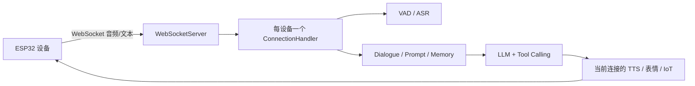
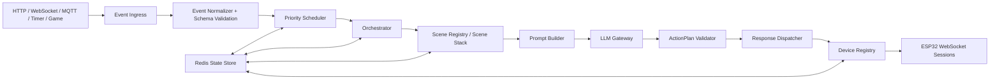

# AI 机器人管理服务器：项目扫描与改造可行性报告

> 评估日期：2026-06-21  
> 需求依据：《AI机器人管理服务器——完整设计文档》v1.0（2026-06-16）  
> 扫描范围：当前 `xiaozhi-server` 工作目录中的 Python 源码、配置、部署文件、运行日志与测试辅助文件

## 1. 结论摘要

### 1.1 总体结论

**该项目可以改造为设计文档中的“多机器人统一大脑与场景编排服务器”，但这不是简单的配置修改，而是一次中等偏大的架构升级。**

现有项目已经提供了较成熟的设备通信、语音链路、LLM/TTS 适配、工具调用、IoT 能力注册、配置和日志底座。建议保留这些能力，在其上新增统一事件、设备注册、场景编排、优先级调度、结构化动作计划、跨设备分发和 Redis 状态层。

不建议推倒重写。推荐采用“渐进式替换”：

1. 保留当前 ESP32 WebSocket 协议和音频/TTS 能力。
2. 将 `ConnectionHandler` 从“每台设备自己的完整 AI”逐步收缩为“设备会话与执行适配器”。
3. 新增服务器级 `Orchestrator`，统一接收事件、调用 LLM、生成动作计划。
4. 新增 `DeviceRegistry` 和 `Dispatcher`，把一次决策分发给多个机器人。
5. 最后引入 Redis，使场景和会话状态可恢复、可多实例共享。

### 1.2 复用比例判断

按能力而非代码行估算：

- 可直接或经轻度封装复用的基础设施：约 **55%～65%**
- 已经满足的目标业务编排能力：约 **15%～25%**
- 需要新建或重构的核心：统一事件模型、调度器、场景系统、中央设备注册表、动作分发器、Redis 状态层

### 1.3 最关键的判断

当前系统已经能够让多台设备分别连接服务器，但每个连接拥有自己的会话、上下文和回复链路。它们是“多个独立 AI 客户端”，还不是“共享一个剧情和决策上下文的 AI 剧团”。

目标架构的真正改造点，不是让三台机器人都连上，而是：

- 一次外部事件只进入一个统一编排流程；
- LLM 能看到所有在线机器人的身份、能力和当前场景；
- 一次 LLM 决策可以产生多个角色动作；
- 服务器可以对正在执行的场景进行排队、打断、暂停、恢复或合并；
- 动作能够被可靠地分发到指定机器人，并收到执行结果。

---

## 2. 项目规模与健康度

### 2.1 扫描结果

- Python 文件：173 个（包含性能测试和个人测试脚本）
- 主要文本源码与配置：约 28,031 行
- `core/connection.py`：1,655 行
- `ConnectionHandler`：约 1,579 行、33 个方法
- `ConnectionHandler.chat()`：333 行
- 本地模型目录：约 944 MB
- 服务版本：`0.9.3`

### 2.2 静态检查

- 173 个 Python 文件全部可被 AST 解析。
- 未发现 Python 语法错误。
- `core/providers/llm/system_prompt.py` 存在一处无效转义警告。
- 项目中没有正式的 `pytest` / `unittest` 测试套件。
- `performance_tester/` 主要是供应商性能测试，不等于业务回归测试。
- `mytest/` 主要是 GUI、统计脚本和录音样本，不具备自动验收能力。
- 当前目录没有可用的 Git 元数据，也没有 README、CI 配置和标准项目元数据文件。

### 2.3 运行日志反映的实际状态

日志表明当前项目并非空壳：

- 2026-06-20 已成功加载 DeepSeek LLM。
- FunASR 已初始化。
- ESP32 设备已通过 WebSocket 接入。
- 已完成语音识别和 TTS 播放。

同时存在以下运行问题：

- 工具定义重名导致 LLM 返回 HTTP 400：`Tool names must be unique`。
- 天气插件鉴权失败。
- MCP 服务配置文件缺失。
- 声纹配置不完整，因此被禁用。
- 较早日志中出现过 FunASR 数据类型错误。

这些问题不阻止架构改造，但应在增加编排复杂度之前处理。

---

## 3. 当前项目功能

### 3.1 网络与设备接入

项目启动入口为 `app.py`，同时启动：

- WebSocket 服务，默认端口 `8000`
- HTTP 服务，默认端口 `8003`
- OTA 接口
- 视觉分析接口
- 全局 GC 管理

WebSocket 服务通过 `device-id`、`client-id` 和可选 Token 识别设备。每个连接创建一个独立的 `ConnectionHandler`。

当前支持的文本消息类型包括：

- `hello`
- `abort`
- `listen`
- `iot`
- `mcp`
- `server`
- `ping`

### 已有优势

- ESP32 通信协议已经跑通。
- 已有设备认证框架。
- 已有断线清理、超时、心跳和 OTA 能力。
- 已有 MQTT 网关音频包兼容代码。

### 当前限制

- `WebSocketServer` 没有维护服务器级在线连接表。
- 无法通过 `device_id` 从中央模块查询并向指定机器人发送动作。
- 连接关闭后，状态主要丢失或交给外部管理 API。
- 每个连接独立处理 LLM、TTS、工具和对话。

### 3.2 音频、ASR、VAD 与 TTS

项目已有较完整的语音链路：

- VAD：Silero 等
- ASR：FunASR、阿里云、讯飞、腾讯、百度、豆包、OpenAI、Vosk、Sherpa-ONNX 等
- TTS：Edge、豆包、阿里云、讯飞、腾讯、FishSpeech、GPT-SoVITS、OpenAI 等
- Opus 音频收发和速率控制
- 流式与非流式 ASR/TTS
- 打断时清空 TTS 队列
- 文本、STT、TTS 状态和表情消息发送

目标设计中机器人不使用麦克风和摄像头，因此这些能力可以保留为兼容层，但不应继续成为编排核心的前置依赖。

当前已经存在文本直达路径：

```json
{
  "type": "listen",
  "state": "detect",
  "text": "大家好"
}
```

该消息可以绕过音频识别，直接触发对话。  
但目前仅存在 WebSocket 设备侧文本输入，没有面向 Streamlit、游戏服务器或管理系统的标准 HTTP 事件入口。

另外，当前组件初始化仍默认假设 ASR 存在。若直接从 `selected_module` 删除 ASR/VAD，连接初始化可能失败。因此“禁用 ASR/VAD”需要增加空实现或能力开关，不能只删配置。

### 3.3 LLM 适配层

项目已有统一 LLM 基类和动态 Provider 加载能力，支持：

- OpenAI 兼容接口
- DeepSeek
- Ollama
- Gemini
- Dify
- FastGPT
- Coze
- Xinference
- Home Assistant 等

当前实际覆盖配置已经选择：

- LLM：DeepSeek
- ASR：FunASR
- TTS：EdgeTTS
- Memory：关闭
- Intent：function calling

DeepSeek 通过 OpenAI 兼容 Provider 接入，因此设计文档 Phase 1 中“替换 LLM 为 DeepSeek”已经基本完成。

### 当前限制

- LLM 调用与当前设备的 TTS、表情、工具执行紧密耦合。
- `ConnectionHandler.chat()` 会边读取 LLM 流边直接向当前设备 TTS 队列写入。
- LLM 输出默认只属于当前连接，不能自然地描述并分发多机器人动作。
- 意图识别和记忆可以创建额外 LLM 实例，因此当前并非严格意义上的“所有智能决策只有一个调用点”。
- 缺少动作计划 JSON Schema、结构校验、修复重试和降级策略。

### 3.4 Prompt、上下文与记忆

现有能力包括：

- Jinja2 Prompt 模板
- 时间、地点、天气、设备 ID 等动态变量
- 外部 `context_providers` HTTP 数据注入
- 对话历史
- 短期本地记忆
- Mem0、PowerMem 等记忆 Provider
- 声纹说话人信息注入
- 工具调用 few-shot

这些能力可以复用于目标系统的 `PromptBuilder`。

### 当前限制

- Prompt 面向单设备、单角色。
- 对话历史保存在当前 `ConnectionHandler` 的内存中。
- 默认 Memory 为 `nomem`。
- 本地短期记忆保存到 YAML 文件，不适合多实例。
- 没有场景上下文、活动场景列表、场景恢复数据和全部机器人状态。

### 3.5 工具、插件、IoT 与 MCP

项目已有统一工具框架，支持：

- 服务端 Python 插件
- 服务端 MCP
- 设备端 MCP
- MCP Endpoint
- 设备端 IoT

服务端插件会自动扫描 `plugins_func/functions/` 并注册函数。现有插件包括天气、时间、新闻、联网搜索、音乐、Home Assistant 和角色切换等。

设备可上报 IoT 描述：

- 属性
- 方法
- 方法参数
- 当前状态

服务器可以把这些描述动态转换成 LLM 工具，并通过 WebSocket 发送 IoT 控制命令。

这部分与设计文档中的“设备能力注册”高度相关，是非常值得复用的基础。

### 当前限制

- IoT 描述和状态保存在当前连接对象中。
- 工具只能自然地作用于当前连接对应的设备。
- 不存在服务器级机器人能力目录。
- 不存在跨连接的目标路由。
- 工具名冲突目前只会被覆盖或最终导致 LLM API 报错，缺少命名空间和启动期强校验。

设计文档决定“不使用 MCP”。建议不要删除现有 MCP 代码，只需在新编排路径中默认关闭。它可以继续作为兼容能力存在。

### 3.6 配置、管理和部署

已有能力：

- `config.yaml` 默认配置
- `data/.config.yaml` 本地覆盖配置
- 可从 manager-api 动态读取配置
- 配置缓存
- Docker Compose 单服务部署
- Docker Compose 全量部署
- MySQL、Redis、manager-web 组合
- 日志和运行指标辅助

需要特别说明：全量 Compose 中虽然存在 Redis，但 Python 服务当前没有 Redis 客户端依赖，也没有使用 Redis 保存会话、场景、机器人状态或事件队列。现有 Redis 主要服务于管理端体系，不能视为设计文档中的状态层已经完成。

---

## 4. 当前代码结构

```text
xiaozhi-server/
├── app.py                         # 启动 WebSocket 与 HTTP 服务
├── config.yaml                    # 默认配置
├── data/.config.yaml              # 实际覆盖配置，含敏感信息
├── core/
│   ├── websocket_server.py        # WebSocket 接入、认证、连接创建
│   ├── connection.py              # 单连接核心，职责过多
│   ├── http_server.py             # OTA 和视觉 HTTP 路由
│   ├── api/                       # OTA、视觉接口
│   ├── handle/                    # WebSocket 消息、音频与打断处理
│   ├── providers/
│   │   ├── asr/                   # ASR Provider
│   │   ├── vad/                   # VAD Provider
│   │   ├── tts/                   # TTS Provider
│   │   ├── llm/                   # LLM Provider
│   │   ├── memory/                # 记忆 Provider
│   │   ├── intent/                # 意图识别
│   │   └── tools/                 # 插件、IoT、MCP 工具体系
│   └── utils/                     # Prompt、缓存、对话、音频等
├── plugins_func/functions/        # 服务端函数插件
├── models/                        # 本地 ASR/VAD 模型
├── performance_tester/            # Provider 性能测试
├── mytest/                        # 临时测试和录音样本
└── docker-compose*.yml            # 部署编排
```

### 4.1 当前主链路



主链路的核心特征是“连接即智能体”。  
目标架构需要把它改成“连接是执行端，服务器编排器才是智能体”。

### 4.2 主要结构性问题

### `ConnectionHandler` 职责过多

它同时负责：

- 连接生命周期
- 认证后的设备上下文
- 音频接收
- ASR/VAD/TTS 初始化
- Prompt
- 对话历史
- 记忆
- 意图识别
- 工具调用
- LLM 流处理
- 表情
- 上报
- 超时
- 服务重启
- 队列清理

这会使中央编排很难直接复用其中某一段能力。

### 决策与执行没有分离

当前 LLM 输出文本后立即写入当前设备 TTS 队列。目标系统需要先产生独立的 `ActionPlan`，再交由分发器执行。

### 状态是进程内和连接内的

- 对话在 `Dialogue` 对象中。
- IoT 能力在连接对象中。
- Prompt 缓存在进程内。
- 本地记忆在 YAML 文件中。
- 没有场景状态和事件状态。

因此当前服务不能达到设计文档要求的无状态多实例。

---

## 5. 与目标需求的逐项对照

| 目标能力 | 当前状态 | 可行性 | 说明 |
|---|---|---:|---|
| 多台 ESP32 同时连接 | 部分具备 | 高 | 每台设备可独立连接，但无中央在线设备表 |
| 机器人作为纯执行终端 | 部分具备 | 高 | 可通过文本和 IoT 执行，但当前仍由每个连接自行完成 AI 对话 |
| DeepSeek 作为主要 LLM | 已具备 | 高 | 实际覆盖配置已启用 DeepSeek |
| 文本输入 | 部分具备 | 高 | WebSocket `listen/detect` 已支持；缺 HTTP 标准事件 API |
| 禁用麦克风、ASR、VAD | 部分具备 | 高 | 可不发送音频；彻底禁用需要空 Provider 或初始化开关 |
| 唯一 LLM 调用出口 | 部分具备 | 中 | Provider 抽象存在，但调用分散在连接、意图和记忆逻辑 |
| 标准事件模型 | 缺失 | 高 | 需要新建 DTO、校验和入口适配器 |
| 优先级事件队列 | 缺失 | 中 | 当前队列用于音频/TTS，不是业务事件调度 |
| 抢占、暂停、恢复 | 仅有单连接 TTS 打断 | 中高 | 现有 `abort` 可复用，但缺场景级状态机 |
| 场景栈 | 缺失 | 中高 | 需要新建并明确持久化和恢复语义 |
| 场景插件框架 | 缺失 | 高 | 现有函数插件可借鉴加载机制，但接口不同 |
| 场景合并 | 缺失 | 中低 | 需要先明确合并规则，不能只实现一个 `merge()` 方法 |
| 场景 Prompt 构造器 | 部分具备 | 高 | PromptManager 和 ContextProvider 可复用 |
| 多角色一次生成 | 缺失 | 中 | 需要结构化输出、Schema 校验和角色约束 |
| 多设备同时下发 | 缺失 | 中 | TTS/IoT 单连接能力存在，缺中央路由和并发调度 |
| 设备能力注册 | 部分具备 | 高 | IoT descriptors 可升级为机器人能力注册协议 |
| Redis 会话/场景/设备状态 | 缺失 | 中 | Compose 有 Redis，但 Python 服务未使用 |
| 多服务实例 | 缺失 | 中低 | 需要状态外部化、队列原子性、连接归属路由 |
| 简历 API 集成 | 通用能力部分具备 | 高 | 已有 HTTP context provider 和插件，缺具体场景 |
| 游戏事件集成 | 缺失标准入口 | 高 | 新增事件 API/WebSocket/MQTT Adapter 即可 |
| 主动聊天 | 缺失 | 高 | 用定时器产生 `timer_trigger` 事件，不需要主动轮询 |

---

## 6. 推荐目标架构

### 6.1 总体架构



### 6.2 推荐的边界

### Device Gateway

负责：

- 接入 ESP32
- 认证
- 保存当前 WebSocket 会话
- 接收 hello、heartbeat、capabilities、ack
- 发送 speak、action、emotion、display、stop
- 不负责决定机器人说什么

### Device Registry

以 `device_id` 为键维护：

- 是否在线
- 当前连接归属实例
- 机器人角色
- 能力列表
- 默认音色
- 当前动作
- 当前场景
- 最后心跳
- 并发执行锁

单实例阶段可以使用内存映射；多实例阶段将元数据写入 Redis，连接对象仍只存在于拥有该 WebSocket 的实例。

### Event Ingress

为所有输入建立统一入口：

- ESP32 文本
- 管理页面文本
- Streamlit
- 游戏服务器
- 定时器
- 系统事件
- 外部 API

协议适配器只负责转换，不参与业务决策。

### Priority Scheduler

负责：

- TTL 过期
- 优先级排序
- 同优先级 FIFO
- 幂等
- 抢占判断
- 防止低优先级长期饥饿

Redis 实现时不能只使用普通列表。可选方案：

1. Redis Streams 保存可靠事件，另用 Sorted Set 维护调度优先级。
2. Sorted Set + Lua 完成原子取出、租约和重试。

如果目标只是三台机器人单实例 MVP，可先用 `asyncio.PriorityQueue`，但接口必须从第一天就抽象为 `EventBus`，方便后续替换 Redis。

### Orchestrator

负责：

- 读取当前场景和机器人状态
- 判断排队、抢占或合并
- 调用场景生命周期
- 构建 Prompt
- 调用唯一 LLM Gateway
- 校验动作计划
- 更新状态
- 调用分发器

### Scene Plugin

场景插件只描述业务行为，不直接操作 WebSocket。

推荐生命周期：

- `on_enter`
- `on_event`
- `on_pause`
- `on_resume`
- `on_exit`
- `build_prompt_context`
- `validate_plan`
- `reduce_state`

建议把设计文档中的 `execute()` 移出 Scene，由 `Dispatcher` 统一执行。否则场景插件容易绕开调度、审计和权限控制。

### LLM Gateway

这是“唯一 LLM 出口”的逻辑边界：

- Provider 选择
- 超时和重试
- 限流
- Token 统计
- 结构化输出
- JSON 修复
- 降级模型
- 熔断
- Trace ID

记忆总结、意图识别等若继续调用模型，也应通过该 Gateway，而不是各自创建 Provider。

### Response Dispatcher

负责：

- 按 `target` 查找在线设备
- 校验设备能力
- 将统一动作映射到当前 xiaozhi WebSocket/IoT 协议
- 并发下发
- 收集 ack
- 超时、重试、取消
- 记录每个动作的执行状态

---

## 7. 建议的数据协议

### 7.1 标准事件

在设计文档格式上建议增加版本、关联和幂等字段：

```json
{
  "schema_version": "1.0",
  "id": "evt_01",
  "type": "text_input",
  "source": "streamlit",
  "priority": 8,
  "occurred_at": 1782000000,
  "expires_at": 1782000030,
  "correlation_id": "corr_01",
  "idempotency_key": "streamlit-req-1001",
  "session_id": "sess_01",
  "actor": {
    "type": "user",
    "id": "user_001"
  },
  "targets": [],
  "data": {
    "text": "请开始今天的模拟面试"
  }
}
```

不建议只保存 `timestamp + ttl`，服务间传递时直接使用 `expires_at` 更容易判断。

### 7.2 LLM 动作计划

```json
{
  "schema_version": "1.0",
  "plan_id": "plan_01",
  "scene_id": "interview",
  "response": "面试开始",
  "actions": [
    {
      "action_id": "act_01",
      "target": "moss",
      "type": "speak",
      "payload": {
        "text": "欢迎参加今天的面试"
      },
      "interrupt_policy": "interruptible",
      "timeout_ms": 15000
    },
    {
      "action_id": "act_02",
      "target": "doly",
      "type": "emotion",
      "payload": {
        "emotion": "happy"
      },
      "timeout_ms": 3000
    }
  ],
  "scene_state_patch": {
    "round": 1
  }
}
```

必须使用 Pydantic/JSON Schema 校验，不能直接相信 LLM JSON。

### 7.3 动作确认

机器人或网关应返回：

```json
{
  "type": "action_ack",
  "action_id": "act_01",
  "device_id": "moss",
  "status": "completed",
  "error": null,
  "timestamp": 1782000010
}
```

没有 ack 时，服务器无法区分“已发送”和“已执行”。

---

## 8. 建议的代码改造

### 8.1 新增目录

```text
core/
├── events/
│   ├── models.py
│   ├── normalizer.py
│   └── bus.py
├── orchestration/
│   ├── orchestrator.py
│   ├── scheduler.py
│   ├── policies.py
│   └── context.py
├── scenes/
│   ├── base.py
│   ├── registry.py
│   ├── stack.py
│   ├── chat.py
│   ├── proactive.py
│   ├── resume.py
│   ├── interview.py
│   └── performance.py
├── devices/
│   ├── registry.py
│   ├── session.py
│   ├── capabilities.py
│   └── protocol_adapter.py
├── dispatch/
│   ├── models.py
│   ├── dispatcher.py
│   └── action_mapper.py
├── state/
│   ├── base.py
│   ├── memory_store.py
│   └── redis_store.py
├── llm_gateway/
│   ├── gateway.py
│   ├── structured_output.py
│   └── retry_policy.py
└── api/
    └── event_handler.py
```

### 8.2 需要修改的现有文件

### `app.py`

- 初始化 EventBus、StateStore、DeviceRegistry、Dispatcher、Orchestrator。
- 统一管理组件生命周期。
- 增加优雅停机：停止接收事件、等待动作完成、归还队列租约。

### `core/websocket_server.py`

- 保存 `device_id -> DeviceSession`。
- 连接成功时注册，断开时注销。
- 将 DeviceRegistry 注入连接。
- 不再让每个连接成为独立的完整 AI 编排器。

### `core/connection.py`

这是改造量最大的文件。

建议逐步拆分：

- 保留网络和音频会话职责。
- 提取 TTS 发送为 `DeviceSession.speak()`。
- 提取表情、显示、IoT 为统一动作方法。
- 将 `chat()` 从默认主链路移出。
- 保留原单机器人对话路径作为兼容模式。
- 新编排模式下，将用户文本转换成 Event 后提交给 Orchestrator。

### `core/http_server.py`

新增：

- `POST /api/v1/events`
- `POST /api/v1/text`
- `GET /api/v1/robots`
- `GET /api/v1/scenes`
- `POST /api/v1/scenes/{scene_id}/start`
- `POST /api/v1/scenes/current/interrupt`
- 健康检查和就绪检查

### `core/handle/textHandler/listenMessageHandler.py`

- `detect/text` 不再直接调用当前连接的 `startToChat()`。
- 转换为 `human_speech` 或 `text_input` 事件。
- 保留兼容开关，例如 `orchestrator.enabled=false` 时走旧路径。

### `core/providers/tools/`

- 增加工具命名空间和启动期唯一性校验。
- 将设备 IoT 工具从“当前连接”升级为“目标设备”。
- 工具调用和机器人动作必须区分，避免所有动作都暴露给 LLM 作为普通工具。

### `config.yaml`

新增：

- `orchestrator`
- `event_bus`
- `redis`
- `robots`
- `scenes`
- `dispatcher`
- `security`
- `observability`

### `requirements.txt`

建议增加：

- `redis`
- `pydantic`
- `jsonschema`（如不完全依赖 Pydantic）
- 测试依赖应放入单独的开发依赖文件

### 8.3 不建议修改或重写的部分

优先保留：

- 各类 LLM Provider
- 各类 TTS Provider
- ASR/VAD Provider
- Opus 发送和速率控制
- OTA
- 认证算法
- IoT descriptor 的解析思想
- Prompt 模板基础设施
- 插件自动发现机制

---

## 9. 推荐实施路线

### Phase 0：安全与稳定性基线

目标：先保证当前单机器人链路可重复运行。

任务：

- 立即轮换明文 DeepSeek API 密钥。
- 改为环境变量或密钥管理注入。
- 启用设备认证，至少在非隔离网络中启用。
- 修改 Docker 默认数据库密码。
- 日志中脱敏 Authorization、设备标识和用户原文。
- 修复工具名称重复。
- 修复天气插件鉴权。
- 明确 MCP 是关闭、删除还是补齐配置。
- 为现有文本对话、TTS、打断增加自动化测试。
- 建立 Git、README、`.gitignore` 和基础 CI。

建议工作量：1～2 人周。

### Phase 1：设备网关与中央注册表

目标：服务器可以按机器人 ID 找到连接并发送动作。

任务：

- 实现 `DeviceSession`。
- 实现 `DeviceRegistry`。
- 将 TTS、表情、显示和 IoT 控制封装成设备动作。
- 增加能力配置和在线状态查询。
- 保留旧对话路径。

验收：

- 三台机器人可同时在线。
- 管理 API 能查看每台机器人的能力与状态。
- 服务器可指定任意在线机器人说一句话或执行动作。

建议工作量：2～3 人周。

### Phase 2：统一事件与基础编排

目标：实现单场景、单 LLM 出口、跨设备动作计划。

任务：

- 标准事件模型。
- HTTP 文本和外部事件入口。
- 内存 EventBus。
- Orchestrator。
- LLM Gateway。
- ActionPlan Schema。
- Dispatcher。
- 基础闲聊场景。

验收：

- 一次文本事件只触发一次主决策。
- LLM 可以返回多个机器人动作。
- 多台机器人按计划发言和动作。
- 无效 JSON 自动重试或降级。

建议工作量：2～4 人周。

### Phase 3：场景栈与优先级

目标：支持暂停、恢复、抢占和场景插件。

任务：

- ScenePlugin 基类。
- SceneRegistry。
- SceneStack。
- PriorityScheduler。
- interrupt/pause/resume。
- 聊天和主动聊天插件。
- 场景级测试。

验收：

- 面试场景可被紧急事件打断。
- 紧急事件结束后自动恢复面试状态。
- 低优先级事件排队且不过期执行。
- 新场景无需修改 Orchestrator 核心代码。

建议工作量：3～5 人周。

### Phase 4：Redis 与业务场景

目标：状态可恢复并接入简历、面试、表演和游戏。

任务：

- Redis StateStore。
- 可靠事件队列。
- 会话、场景、机器人状态外部化。
- 简历 API Adapter。
- 虚拟面试。
- 小品表演。
- 游戏事件 Adapter。
- 服务重启恢复。

验收：

- 服务重启后可恢复场景和会话。
- 重复事件不会重复执行。
- 机器人离线时动作进入失败或补偿流程。
- 外部业务系统只提交数据和事件，不直接决定机器人行为。

建议工作量：3～6 人周。

### Phase 5：多实例与生产化

目标：支持高可用部署。

任务：

- Redis 消费者组或租约。
- 分布式锁。
- WebSocket 连接实例路由。
- 动作追踪、指标、告警。
- 压力测试和故障注入。

建议工作量：2～4 人周。

### 总体工作量

在不包含 ESP32 固件大改和场景内容创作的情况下，建议按 **10～18 人周** 估算。  
单人开发通常需要约 3～5 个月；两名熟悉异步 Python 和设备协议的开发者可并行缩短。

---

## 10. 优先级与风险

| 等级 | 风险 | 影响 | 建议 |
|---|---|---|---|
| P0 | 实际 API Key 明文保存在 `data/.config.yaml` | 密钥泄露、费用风险 | 立即轮换并改用环境变量 |
| P0 | 默认 WebSocket 认证关闭 | 任意局域网设备可能接入 | 生产环境强制认证 |
| P0 | 工具重名导致 DeepSeek 400 | 对话直接失败 | 启动期校验并引入命名空间 |
| P1 | `ConnectionHandler` 高度耦合 | 改造容易产生回归 | 先增加适配层，再迁移主链路 |
| P1 | LLM 输出直接驱动 TTS | 无法多设备分发和审计 | 引入 ActionPlan |
| P1 | 无正式测试 | 重构风险不可控 | 先覆盖当前主链路 |
| P1 | 状态主要在内存 | 重启和多实例丢失状态 | StateStore 抽象后接 Redis |
| P1 | 日志记录完整 Headers 和消息 | 隐私和凭证风险 | 脱敏与日志分级 |
| P2 | 场景“合并”语义不明确 | 容易产生不可预测状态 | 先定义合并矩阵和冲突规则 |
| P2 | TTS 并发和供应商限流 | 多角色同时发言失败 | 每设备队列、全局限流和重试 |
| P2 | 机器人动作无 ack | 无法确认执行结果 | 增加 action_ack |
| P2 | Compose 使用弱数据库密码 | 部署安全风险 | 改为 Secret/环境变量 |

---

## 11. 设计文档中需要进一步明确的事项

以下问题不会阻止 Phase 1，但应在场景系统开发前确定：

1. “唯一 LLM”是指唯一模型、唯一 Provider 实例，还是唯一逻辑网关？
2. 场景作用域是全局、某一组机器人、某个用户，还是某个会话？
3. 两个场景“合并”时，Prompt、状态、角色和结束条件如何组合？
4. 高优先级事件是永远抢占，还是由场景的中断矩阵决定？
5. 一个机器人同一时刻能否同时执行动作和说话？
6. 多个机器人是并行说话，还是按剧本顺序说话？
7. 离线机器人动作是丢弃、重试、改派还是等待？
8. 机器人能力是服务器静态配置，还是设备连接时动态上报？
9. 场景恢复后是否需要从被打断的句子继续，还是从下一个动作继续？
10. ESP32 现有 IoT 描述是否已经覆盖舵机、轮子、屏幕和表情的全部动作？
11. 管理 API、游戏服务器和 Streamlit 的认证方式是什么？
12. 关键业务可接受的端到端延迟是多少？

---

## 12. 最终建议

### 建议采用的方案

采用“保留设备与 AI Provider 底座，新增中央编排核心”的方案。

第一阶段不要立即引入完整 Redis、多实例和所有场景。先完成：

1. 密钥和认证整改。
2. 工具重名与现有运行错误修复。
3. DeviceRegistry。
4. 标准文本事件入口。
5. 单一 Orchestrator。
6. 多设备 ActionPlan 分发。
7. 一个基础闲聊场景。

这条链路跑通后，再增加场景栈、优先级和 Redis。这样可以尽早验证最重要的产品假设：**一次 LLM 决策能否稳定地协调三台真实机器人完成多角色互动。**

### 不建议的方案

- 不建议直接在现有 `ConnectionHandler.chat()` 中继续堆叠场景判断。
- 不建议让每个场景直接持有 WebSocket 并下发动作。
- 不建议让 LLM 直接生成未经校验的底层电机参数。
- 不建议一开始就做多实例和复杂场景合并。
- 不建议为了“不使用 MCP”而删除整套现有工具代码。
- 不建议继续把真实密钥存放在项目配置文件中。

### 可行性评级

- 技术可行性：**高**
- 复用价值：**高**
- 改造复杂度：**中高**
- 当前生产就绪度：**低**
- 完成 Phase 1～3 后的 MVP 可用性：**高**

---

## 13. 关键判断的代码证据

| 判断 | 代码位置 |
|---|---|
| 当前服务版本为 0.9.3 | `config/logger.py:8` |
| 每个 WebSocket 连接创建独立 `ConnectionHandler` | `core/websocket_server.py:81`、`core/websocket_server.py:117` |
| 每个连接创建独立 session 和 Dialogue | `core/connection.py:90`、`core/connection.py:161` |
| 文本输入可通过 `listen/detect` 进入当前对话链路 | `core/handle/textHandler/listenMessageHandler.py:47`、`:77` |
| HTTP 当前主要暴露 OTA 和视觉接口 | `core/http_server.py:47`、`:66` |
| 实际覆盖配置已选择 DeepSeek | `data/.config.yaml:238` |
| 工具系统已支持服务插件、IoT 与 MCP | `core/providers/tools/unified_tool_handler.py:19` |
| 设备 IoT 能力支持动态注册 | `core/providers/tools/unified_tool_handler.py:218` |
| 当前全局缓存是进程内缓存，不是 Redis | `core/utils/cache/manager.py:13`、`:216` |
| 当前配置默认关闭 WebSocket 认证 | `data/.config.yaml:31`、`:33` |
| 消息和连接 Headers 会被完整写入日志 | `core/connection.py:208`、`core/handle/textMessageProcessor.py:28` |
